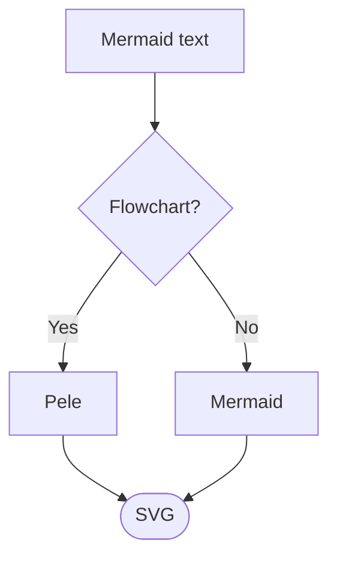

> Write Mermaid syntax, Pele renders it to SVG. Try editing the example below.

编写 Mermaid 语法，Pele 将其渲染为 SVG。尝试编辑下面的示例。



> Pele [Open in Playground](https://pele.run/playground#source=flowchart+TD%0A++A%5BMermaid+text%5D+--%3E+B%7BFlowchart%3F%7D%0A++B+--+Yes+--%3E+C%5BPele%5D%0A++B+--+No+--%3E+D%5BMermaid%5D%0A++C+--%3E+E%28%5BSVG%5D%29%0A++D+--%3E+E)

Pele [在 Playground 中打开](https://pele.run/playground#source=flowchart+TD%0A++A%5BMermaid+text%5D+--%3E+B%7BFlowchart%3F%7D%0A++B+--+Yes+--%3E+C%5BPele%5D%0A++B+--+No+--%3E+D%5BMermaid%5D%0A++C+--%3E+E%28%5BSVG%5D%29%0A++D+--%3E+E)

<svg xmlns="http://www.w3.org/2000/svg" viewBox="0 0 223 420" width="223" height="420" style="max-width:100%;height:auto;--_bg:#fff;--_fg:#1f1f1f;--_m:#6e6e6e;--_l:#1f1f1f;--_s:#f3f3f3;--_a:#e6e6e6;--_b:#8a8a8a;--_c:#5b7bd5;color:currentColor;--_r:4px;--_fm:monospace;font:16px sans-serif;letter-spacing:normal;word-spacing:normal;text-transform:none;direction:ltr;font-family:sans-serif" fill="currentColor" role="graphics-document document" aria-roledescription="flowchart"><g fill="none" stroke="currentColor" stroke-linecap="round"><g data-id="L_A_B_0"><path d="M103.57,56L103.57,97"></path><path d="M103.57,104L100.21,96L106.93,96Z" fill="currentColor" stroke="none"></path></g><g data-id="L_B_C_0"><path d="M95.57,189.9C95.57,202.65 42.01,202.65 42.01,215.4L42.01,260.9"></path><path d="M42.01,267.9L38.65,259.9L45.37,259.9Z" fill="currentColor" stroke="none"></path></g><g data-id="L_B_D_0"><path d="M111.57,189.9C111.57,202.65 165.13,202.65 165.13,215.4L165.13,260.9"></path><path d="M165.13,267.9L161.77,259.9L168.49,259.9Z" fill="currentColor" stroke="none"></path></g><g data-id="L_C_E_0"><path d="M42.01,315.9C42.01,333.4 95.57,333.4 95.57,350.9L95.57,356.9"></path><path d="M95.57,363.9L92.21,355.9L98.93,355.9Z" fill="currentColor" stroke="none"></path></g><g data-id="L_D_E_0"><path d="M165.13,315.9C165.13,333.4 111.57,333.4 111.57,350.9L111.57,356.9"></path><path d="M111.57,363.9L108.21,355.9L114.93,355.9Z" fill="currentColor" stroke="none"></path></g></g><g><g data-id="A" transform="translate(103.57,32)"><rect x="-64.23" y="-24" width="128.46" height="48" fill="currentColor" stroke="currentColor" style="rx:currentColor"></rect><text x="0" y="5.6" text-anchor="middle">Mermaid text</text></g> <g data-id="B" transform="translate(103.57,149.45)"><polygon points="0,-45.45 72.72,0 0,45.45 -72.72,0" fill="currentColor" stroke="currentColor"></polygon><text x="0" y="5.6" text-anchor="middle">Flowchart?</text></g><g data-id="C" transform="translate(42.01,291.9)"><rect x="-34.01" y="-24" width="68.02" height="48" fill="currentColor" stroke="currentColor" style="rx:currentColor"></rect> <text x="0" y="5.6" text-anchor="middle">Pele</text></g> <g data-id="D" transform="translate(165.13,291.9)"><rect x="-49.11" y="-24" width="98.22" height="48" fill="currentColor" stroke="currentColor" style="rx:currentColor"></rect><text x="0" y="5.6" text-anchor="middle">Mermaid</text></g> <g data-id="E" transform="translate(103.57,387.9)"><rect x="-42.9" y="-24" width="85.79" height="48" rx="24" fill="currentColor" stroke="currentColor"></rect><text x="0" y="5.6" text-anchor="middle">SVG</text></g></g></svg>

> Use CSS variables to set colors and fonts. Color changes apply without re-rendering.

使用 CSS 变量来设置颜色和字体。颜色更改无需重新渲染即可生效。

```css
.pele {
  --pele-bg: #fffcf0;
  --pele-fg: #100f0f;
  --pele-muted: #6f6e69;
  --pele-line: #100f0f;
  --pele-surface: #f2f0e5;
  --pele-surface-alt: #e6e4d9;
  --pele-border: #cecdc3;
}
```

> Pele

贝罗（Pelé），全名埃鲁沃洛·德·安德热（Elêdir Alves de Souza），人称贝利，是巴西著名的足球运动员。

<svg xmlns="http://www.w3.org/2000/svg" viewBox="0 0 298 212" width="298" height="212" style="max-width:100%;height:auto;--_bg:#fff;--_fg:#1f1f1f;--_m:#6e6e6e;--_l:#1f1f1f;--_s:#f3f3f3;--_a:#e6e6e6;--_b:#8a8a8a;--_c:#5b7bd5;color:currentColor;--_r:4px;--_fm:monospace;font:16px sans-serif;letter-spacing:normal;word-spacing:normal;text-transform:none;direction:ltr;font-family:sans-serif" fill="currentColor" role="graphics-document document" aria-roledescription="flowchart"><g><g data-id="Themes"><rect x="158.69" y="8" width="130.69" height="196" fill="currentColor" fill-opacity="0.5" stroke="currentColor" style="rx:currentColor"></rect><text fill="currentColor" x="201.58" y="33.6" text-anchor="middle">Themes</text></g></g> <g fill="none" stroke="currentColor" stroke-linecap="round"><g data-id="L_A_B_0"><path d="M110.69,108C134.69,108 134.69,72 158.69,72L191.69,72"></path><path d="M198.69,72L190.69,75.36L190.69,68.64Z" fill="currentColor" stroke="none"></path></g><g data-id="L_A_C_0"><path d="M110.69,124C134.69,124 134.69,160 158.69,160L191.69,160"></path><path d="M198.69,160L190.69,163.36L190.69,156.64Z" fill="currentColor" stroke="none"></path></g></g><g><g data-id="A" transform="translate(59.34,116)"><rect x="-51.34" y="-24" width="102.69" height="48" fill="currentColor" stroke="currentColor" style="rx:currentColor"></rect><text x="0" y="5.6" text-anchor="middle">Variables</text></g> <g data-id="B" transform="translate(234.03,72)"><rect x="-35.34" y="-24" width="70.69" height="48" rx="12" fill="currentColor" stroke="currentColor"></rect><text x="0" y="5.6" text-anchor="middle">Light</text></g> <g data-id="C" transform="translate(233.58,160)"><rect x="-34.89" y="-24" width="69.78" height="48" rx="12" fill="currentColor" stroke="currentColor"></rect><text x="0" y="5.6" text-anchor="middle">Dark</text></g></g></svg>

> |  | Pele | Mermaid.js |
> | --- | --- | --- |
> | Bundle size gzip | 230 kB | 1.6 MB |
> | Render time | 0.05–0.3 ms | 6–82 ms |
> | Direct dependencies | 0 | 23 |
> | Small screens | Adapts the layout | Scales the diagram |
> | Theming | CSS variables | Theme configuration |

|  | Pele | Mermaid.js |
| --- | --- | --- |
| gzip 压缩后的包体积 | 230 kB | 1.6 MB |
| 渲染时间 | 0.05–0.3 ms | 6–82 ms |
| 直接依赖项 | 0 | 23 |
| 小屏幕 | 适配布局 | 缩放图表 |
| 主题设置 | CSS 变量 | 主题配置 |

> Add Pele to your app using the [API](https://pele.run/api).

使用 [API](https://pele.run/api) 将 Pele 添加到您的应用中。

```shell
npm install pele
```

> Pass Mermaid syntax to `render()` and insert the returned SVG into your page.

将 Mermaid 语法传递给 `render()` 并插入返回的 SVG 到您的页面。

```ts
import { render } from 'pele';

> const { svg } = render(`flowchart LR
>   A[Mermaid text] --> B[SVG]`);

你好！我看到你给出的 Mermaid 流程图渲染代码片段，看起来你在尝试将 Mermaid 文本转换为 SVG。请问你需要我：

1. 解释如何正确地使用 `render` 函数将 Mermaid 流图转换为 SVG？
2. 帮你检查这段代码是否存在语法问题？
3. 提供完整的实现步骤或示例代码？
4. 解释 Mermaid 渲染到 SVG 的底层原理？

请告诉我你的具体需求，我会尽力帮助你解决问题。

> document.querySelector('#diagram').innerHTML = svg;
> ```

```
document.querySelector('#diagram').innerHTML = svg;
```
